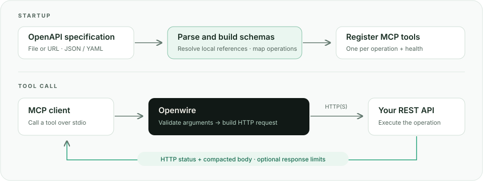

<p align="center">
  <picture>
    <source media="(prefers-color-scheme: dark)" srcset="https://raw.githubusercontent.com/mtellami/openwire/master/assets/brand/logo-dark.svg">
    <source media="(prefers-color-scheme: light)" srcset="https://raw.githubusercontent.com/mtellami/openwire/master/assets/brand/logo.svg">
    
  </picture>
</p>

<h1 align="center">Your API. Ready for AI.</h1>

<p align="center">
  Turn an OpenAPI specification into validated MCP tools.<br>
  One command. No endpoint wrappers.
</p>

<p align="center">
  <a href="https://www.npmjs.com/package/openwire"></a>
  <a href="https://github.com/mtellami/openwire/actions/workflows/ci.yml"></a>
  <a href="https://www.npmjs.com/package/openwire"></a>
  <a href="https://github.com/mtellami/openwire/blob/master/LICENSE"></a>
</p>

<p align="center">
  <a href="#quick-start">Quick start</a> ·
  <a href="#connect-your-mcp-client">Client setup</a> ·
  <a href="#how-it-works">Architecture</a> ·
  <a href="#configuration">Configuration</a> ·
  <a href="#compatibility">Compatibility</a> ·
  <a href="https://github.com/mtellami/openwire/blob/master/ROADMAP.md">Roadmap</a>
</p>

---

Openwire is a [Model Context Protocol](https://modelcontextprotocol.io) server for REST APIs. Give it a local OpenAPI file or a remote specification URL, and it exposes API operations as tools that an MCP client can discover and call over **stdio**.

Use it to connect an existing API to an AI assistant, point the same tools at staging or a local mock, or explore an API without maintaining a separate integration for every endpoint.

## Why Openwire

| Capability                      | What you get                                                                                                                 |
| ------------------------------- | ---------------------------------------------------------------------------------------------------------------------------- |
| **Tools from your spec**        | Operation names, descriptions, parameters, and JSON request bodies become tool definitions at startup.                       |
| **Validation before execution** | Arguments are checked against generated schemas with AJV, including supported string formats, before an API request is made. |
| **Configured authentication**   | Inject static authorization or proxy headers into spec downloads and API requests.                                           |
| **Control over responses**      | Opt into depth, array, string, and serialized character limits to manage model context usage.                                |
| **Predictable failures**        | Validation failures, network errors, and HTTP 4xx/5xx responses are returned as MCP tool errors.                             |
| **A small runtime**             | Node.js, built-in `fetch`, and a stdio connection. No separate HTTP service to deploy.                                       |

## Quick start

**Requirements:** Node.js **20.19 or newer** and an OpenAPI **3.0.x or 3.1.x** specification. See [compatibility](#compatibility) for supported features.

Run directly with npx:

```bash
npx --yes openwire --spec ./openapi.yaml
```

Or install the CLI:

```bash
npm install -g openwire
openwire --spec ./openapi.yaml
```

Remote JSON and YAML specifications work too:

```bash
npx --yes openwire --spec https://api.example.com/openapi.json
```

> Openwire is a stdio subprocess for an MCP client. A terminal waiting for input is expected; connect it to your client to discover and call tools.

## Connect your MCP client

Add Openwire to a client that supports local stdio MCP servers. The following uses the common `mcpServers` configuration format; the file location and settings interface depend on your client.

```json
{
  "mcpServers": {
    "openwire": {
      "command": "npx",
      "args": ["--yes", "openwire", "--spec", "/absolute/path/to/openapi.yaml"],
      "env": {
        "API_BASE_URL": "https://api.example.com"
      }
    }
  }
}
```

For a global installation, set `"command": "openwire"` and use `"args": ["--spec", "/absolute/path/to/openapi.yaml"]`. For a source checkout, use `"command": "node"` with the absolute path to `dist/index.js` followed by `--spec` and your spec path.

Use an absolute local spec path: the client's working directory may differ from your terminal. Restart the connection after changing the specification or configuration; the tool list is built once at startup.

## How it works

<p align="center">
  
</p>

At startup, Openwire loads the spec, resolves supported local references, normalizes schemas, and registers a tool for each operation plus a built-in `health` tool. At runtime, it validates arguments, builds and executes the HTTP request, then compacts the response under any configured limits.

### From endpoint to tool

Given this operation:

```yaml
openapi: 3.0.3
info:
  title: Pet API
  version: 1.0.0
servers:
  - url: https://api.example.com
paths:
  /pets/{petId}:
    get:
      operationId: getPetById
      summary: Find a pet by ID
      parameters:
        - name: petId
          in: path
          required: true
          schema:
            type: string
      responses:
        "200":
          description: A pet record
```

Openwire exposes a `getPetById` tool. Calling it with:

```json
{ "petId": "pet-123" }
```

makes a `GET https://api.example.com/pets/pet-123` request. A successful response is returned as text with its HTTP status, for example:

```text
HTTP 200 OK
{"id":"pet-123","name":"Rex"}
```

| Mapping        | Behavior                                                                                                         |
| -------------- | ---------------------------------------------------------------------------------------------------------------- |
| Tool name      | Normalize `operationId` to camelCase; fall back to the method and path. Collisions receive numeric suffixes.     |
| Tool arguments | Path, query, header, and cookie parameters become top-level properties. Unknown arguments are rejected.          |
| Request body   | Expose JSON payloads under `body`; require it when the spec does.                                                |
| Base URL       | Use operation, path, then document servers, unless `API_BASE_URL` is set.                                        |
| Health check   | The reserved `health` tool accepts an optional `echo` string. An API operation named `health` becomes `health2`. |

## Configuration

```text
openwire [options] [source]
```

| Argument               | Description                                                     |
| ---------------------- | --------------------------------------------------------------- |
| `-s, --spec <source>`  | Local spec path or HTTP(S) URL. Overrides `OPENAPI_SOURCE`.     |
| `<source>`             | Positional alternative to `--spec`.                             |
| `-H, --headers <json>` | JSON object of headers. Overrides header environment variables. |
| `-h, --help`           | Print CLI usage and available environment settings.             |

### Environment variables

| Variable                     | Default                       | Purpose                                                                                         |
| ---------------------------- | ----------------------------- | ----------------------------------------------------------------------------------------------- |
| `OPENAPI_SOURCE`             | Required without a CLI source | Local spec path or HTTP(S) URL.                                                                 |
| `API_BASE_URL`               | Selected server from the spec | Override the base URL for every API call.                                                       |
| `API_TIMEOUT_MS`             | `30000`                       | Timeout in milliseconds for spec downloads and API requests.                                    |
| `OPENAPI_MAX_TOOLS`          | `100`                         | Maximum number of spec operations. Specs above this limit are rejected; `health` is additional. |
| `API_HEADERS`                | Unset                         | JSON header map sent on spec downloads and API requests.                                        |
| `API_AUTH_HEADERS`           | Unset                         | Header map fallback; `API_HEADERS` takes precedence.                                            |
| `API_MAX_RESPONSE_CHARS`     | Unlimited                     | Serialized response-body character budget.                                                      |
| `SANITIZE_MAX_DEPTH`         | Unlimited                     | Maximum JSON nesting depth retained; root depth is zero.                                        |
| `SANITIZE_MAX_ARRAY_LENGTH`  | Unlimited                     | Maximum number of elements retained per array.                                                  |
| `SANITIZE_MAX_STRING_LENGTH` | Unlimited                     | String content retained before an optional truncation marker.                                   |
| `ALLOW_INSECURE_HTTP`        | `false`                       | Permit plain HTTP for spec downloads and API requests.                                          |
| `LOG_LEVEL`                  | `info`                        | `debug`, `info`, `warn`, or `error`. Logs go to stderr.                                         |
| `SERVER_NAME`                | `openwire`                    | MCP server identity reported to the client.                                                     |
| `SERVER_VERSION`             | Package version               | MCP server version reported to the client.                                                      |

### Authenticate requests

Configure precomputed Bearer tokens, Basic authorization values, API-key headers, or custom proxy headers:

```bash
export API_HEADERS='{"Authorization":"Bearer YOUR_TOKEN","X-API-Key":"YOUR_KEY"}'
openwire --spec https://api.example.com/openapi.json
```

For client-managed subprocesses, put `API_HEADERS` in the client's `env` configuration. Keep real credentials out of committed configuration files.

Header precedence is **`--headers` → `API_HEADERS` → `API_AUTH_HEADERS`**: the highest-priority value replaces the entire header map. Configured headers override same-name header parameters supplied in a tool call.

The same headers are sent to the spec URL and the selected API server, so use trusted endpoints. Security schemes are metadata: Openwire does not perform OAuth/OpenID flows, refresh tokens, or automatically inject query/cookie API keys. Use a suitable proxy or restart with updated static credentials when tokens rotate.

### Manage response size

Limits are opt-in. For example:

```bash
export API_MAX_RESPONSE_CHARS=20000
export SANITIZE_MAX_DEPTH=8
export SANITIZE_MAX_ARRAY_LENGTH=50
export SANITIZE_MAX_STRING_LENGTH=2000
openwire --spec ./openapi.yaml
```

The character budget includes JSON escaping, punctuation, and embedded markers. HTTP status lines and the separate `[response truncated]` notice sit outside that budget. JSON remains valid when a value fits; otherwise the response body is empty.

Responses are buffered before sanitization. These options limit output to the client, rather than download size or peak memory usage.

### Use a local API

```bash
export API_BASE_URL=http://localhost:8080
export ALLOW_INSECURE_HTTP=true
openwire --spec ./openapi.yaml
```

## Compatibility

| Area              | Current support                                                                                       |
| ----------------- | ----------------------------------------------------------------------------------------------------- |
| Transport         | Local stdio MCP server.                                                                               |
| Specifications    | OpenAPI 3.0.x and 3.1.x, JSON or YAML, local file or HTTP(S) source.                                  |
| Schema validation | AJV draft-07 with OpenAPI 3.0 normalization; full JSON Schema 2020-12 semantics are not implemented.  |
| References        | Supported local references; external references and recursive schema cycles are rejected.             |
| Request bodies    | `application/json` and `application/*+json`; other encodings return an error when a body is supplied. |
| Parameters        | Scalar/JSON serialization; OpenAPI `style` and `explode` are not fully implemented.                   |
| Servers           | Operation/path/document precedence and a global override; server variables are not expanded.          |
| Authentication    | Static HTTP headers; no token acquisition or refresh.                                                 |

Parameter names share one argument namespace. Duplicate names across locations, or a parameter named `body`, can collide with the request-body argument.

Plain HTTP is refused by default. Configured credentials are not added to tool schemas, and logs omit request headers; upstream response bodies can still echo sensitive information. Invalid specifications prevent initialization; invalid arguments, network failures, and HTTP 4xx/5xx responses produce tool errors.

## Development

```bash
git clone https://github.com/mtellami/openwire.git
cd openwire
npm ci
npm run build
npm start -- --spec ./openapi.yaml
```

| Command                                | Purpose                                                           |
| -------------------------------------- | ----------------------------------------------------------------- |
| `npm run dev -- --spec ./openapi.yaml` | Run the CLI with source watching.                                 |
| `npm run typecheck`                    | Check TypeScript types.                                           |
| `npm run lint`                         | Lint source files.                                                |
| `npm run format:check`                 | Check repository formatting.                                      |
| `npm test`                             | Run unit and MCP integration tests.                               |
| `npm run test:package`                 | Build, pack, install, and verify both CLI names and MCP behavior. |

CI runs checks on Node.js **20, 22, and 24**. Brand assets live in [`assets/brand`](https://github.com/mtellami/openwire/tree/master/assets/brand), and README diagrams live in [`assets/diagrams`](https://github.com/mtellami/openwire/tree/master/assets/diagrams). The README uses absolute image URLs so the same branding renders on GitHub and npm.

For bug reports, include your Node.js version, a minimal specification with secrets removed, the command or client configuration, and the observed error. Use [GitHub Issues](https://github.com/mtellami/openwire/issues) for reports and feature requests, or open a pull request with a focused change and relevant validation.

## Migrating from api-mcp-bridge

```bash
npm uninstall -g api-mcp-bridge
npm install -g openwire
```

Update the MCP command to `openwire`, or use `npx --yes openwire`. Existing environment variable names and CLI arguments remain compatible. The old command is retained as an alias in Openwire 1.2.x; the default server identity is now `openwire`.

## Project

- [Changelog](https://github.com/mtellami/openwire/blob/master/CHANGELOG.md) — release history and migration notes.
- [Roadmap](https://github.com/mtellami/openwire/blob/master/ROADMAP.md) — operation filtering, bounded downloads, OpenAPI compatibility, and authentication improvements.
- [MIT license](https://github.com/mtellami/openwire/blob/master/LICENSE) — maintained by [Moad Tellami](https://github.com/mtellami).

Openwire is an OpenAPI-to-MCP server, unrelated to the Apache ActiveMQ OpenWire protocol.
